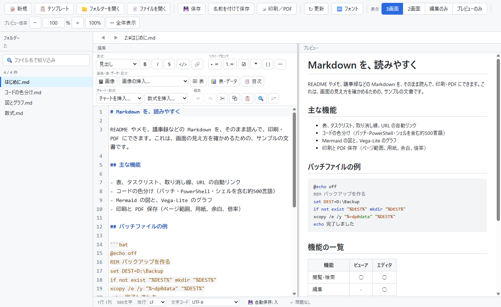

# Handy Markdown Editor

<picture>
  <source media="(prefers-color-scheme: dark)" srcset="docs/images/MarkdownEditor-dark.png">
  
</picture>

Windows 11 向けの Markdown 編集アプリです。左で書き、右でリアルタイムにプレビューします。書いた文書は、そのまま印刷・PDF 保存できます。

Python と pywebview で作り、描画は Microsoft Edge の WebView2 を使います。編集欄は CodeMirror 5 です。

## 主な機能

- 2画面編集（3画面 / 2画面 / 編集のみ / プレビューのみ）。編集欄とプレビューのスクロールの同期
- 書式ボタン（見出し・装飾・リスト・引用・コードブロック・リンクなど）、検索・置換（正規表現）
- 画像の挿入（パスで参照 / Base64 で埋め込み。Base64 のファイル化にも対応）。スクリーンショットは Ctrl+V で貼り付け（images フォルダーに保存してリンクを入れる）
- 目次の作成（プレビューと同じ規則のリンク）
- 複数のウィンドウ（ずらして開く。新しいウィンドウで開く。**同じファイルを別のウィンドウで開くと警告し、読み取り専用で開ける**。自動保存の下書きは、ウィンドウごとに別）
- 一覧はサブフォルダーを階層で開閉でき、戻る・進む（開いたファイルの履歴。Alt+Shift+←／→）も使える
- 定型文（スニペット）を、カーソルの位置へ挿入（注意書き・折りたたみ・チェックリストなど。選んだ文字を包める。自分の定型文は .md を置くだけ。文書フォルダーの `.markdown-editor\` に設定を書き出せば、フォルダーごと持ち出せて、書き換え・削除も自由）
- テンプレートから新規作成（`{{名前}}` の欄を埋めると、欄のない、ふつうの Markdown ができる。日付・曜日などは自動。議事録・リリースノートなどを同梱）
- 表の編集（右クリックで、整形・列と行の追加／削除／移動・配置。全角の幅を考えて列をそろえる。Tab でセルを移動）
- 表・データの取り込み（Excel のセル・CSV・JSON から、Markdown の表・HTML の表・JSON を作る）
- コードの色分け（プレビュー。` ```bat ` のように言語名を書く。バッチ・PowerShell・シェルを含む約500言語）
- Mermaid の図、Vega-Lite のグラフ
- 数式（` ```math `、`$$ … $$`、文中の `$…$`。KaTeX で組む。ダークモード・印刷・PDF に対応）
- 書き方の検査（lint）。`#見出し` や効かない `**` など、書いたつもりと表示が食い違う書き方を、一覧と行番号の横の印で知らせる。リンク切れ・取り除かれる HTML・数式や図の誤りも対象。行末の空白・続く空行・`#` の後の空白・見出しの前後の空行・段飛びは、前後を確かめてから、ボタンで直せる（Ctrl+Z で戻せる）
- 文字コード（UTF-8 / BOM / Shift-JIS / UTF-16）と改行を保った保存、上書き前の退避（残す数を設定可）、他のアプリによる変更の検知、未保存の保護（閉じるときの確認）、自動保存の下書きと、異常終了後の復元
- **フォルダー全体の本文の検索**（一致した行をファイルごとに一覧し、押すとその行を選んで開く。保存していない編集中の内容も探す）
- **HTML への書き出し**（数式・Mermaid・Vega-Lite・コードの色分け・画像も含めて、1つで完結する HTML ファイルに。ネットがなくても同じ見た目で読める）
- 印刷と PDF 保存（ページ範囲、用紙・向き・余白・倍率、改ページの指定）
- 表示倍率、フォントの設定、ダークモード（Windows の設定に従う）、ウィンドウへのドラッグ＆ドロップ、フォルダーの右クリックから開く

## 使う

インストールは不要です。ビルド済みの `MarkdownEditor.exe` を起動します。

```
MarkdownEditor.exe [ファイル.md | フォルダー]
MarkdownEditor.exe --register     エクスプローラーの「プログラムから開く」に登録
MarkdownEditor.exe --unregister   登録を解除
```

動作環境は、Windows 11 と Microsoft Edge WebView2 ランタイムです。使い方の詳細は [取扱説明書](docs/取扱説明書.md) を見てください。

ダークモードは、アプリの設定ではなく、**Windows の設定に自動で従います**。切り替えるときは、Windows の「設定」→「個人用設定」→「色」→「モードを選ぶ」で、「ダーク」または「ライト」を選びます。

## 開発

```
python -m venv .venv
.venv\Scripts\python -m pip install -r requirements.txt
.venv\Scripts\python mdeditor.py [ファイル.md | フォルダー]
```

| 目的 | コマンド |
| --- | --- |
| テスト | `.venv\Scripts\python -m pytest` |
| 画面を実際に動かす確認 | `.venv\Scripts\python tests\gui_check_find.py`（`tests\gui_check_*.py`。設定は一時フォルダーに向ける） |
| exe を作る（テスト → PyInstaller） | `.\build.cmd` |
| 配布用 zip を作る | `python tools\make_release.py` |
| README のスクリーンショットを撮り直す（先に `.\build.cmd`） | `pwsh .\tools\make_screenshots.ps1`（`docs\sample` のサンプル文書を、ライトとダークで撮る） |

主なファイル:

| ファイル | 役割 |
| --- | --- |
| `mdeditor.py` | 本体。Markdown を HTML にして、画面（`ui.html`）へ渡す。文書の読み書きは `filemodel.py` |
| `ui.html` / `find.js` / `format.js` / `print.js` | 画面、検索・置換、書式、印刷ダイアログ |
| `sanitize.py` | 埋め込み HTML の許可リスト方式の除去 |
| `highlight.py` | コードの色分け（Pygments） |
| `imgembed.py` / `toc.py` / `tabular.py` | 画像の挿入・Base64 変換、目次、表・データの取り込み |
| `autolink.py` / `cjk_emphasis.py` | URL の自動リンク、日本語の強調記号 |
| `printing.py` / `shellreg.py` / `filedrop.py` / `uiprefs.py` / `clipboard.py` / `dialogs.py` | 印刷・PDF、エクスプローラーへの登録、ドロップ、設定の保存、クリップボード、ファイルダイアログ |
| `vendor/` | 同梱の外部ライブラリ（CodeMirror 5、Mermaid、Vega / Vega-Lite / vega-embed、iconify の `logos` アイコン集） |

設計や仕様は [簡易仕様書](docs/簡易仕様書.md) にあります。

## 補足

- ライセンスは [MIT](LICENSE) です（Copyright (c) 2026 Hidetoshi 'PePe' Amemiya）。
- 同梱している第三者のライブラリ（Mermaid、Vega、CodeMirror、iconify の `logos`、Python など）のライセンス表示は、[THIRD_PARTY_NOTICES.md](THIRD_PARTY_NOTICES.md) にあります。配布 zip にも同じものを入れています。
- 姉妹アプリの Handy Markdown Viewerとは、`autolink.py`、`cjk_emphasis.py`、`sanitize.py`、`highlight.py` などを、同じ内容で持っています。
